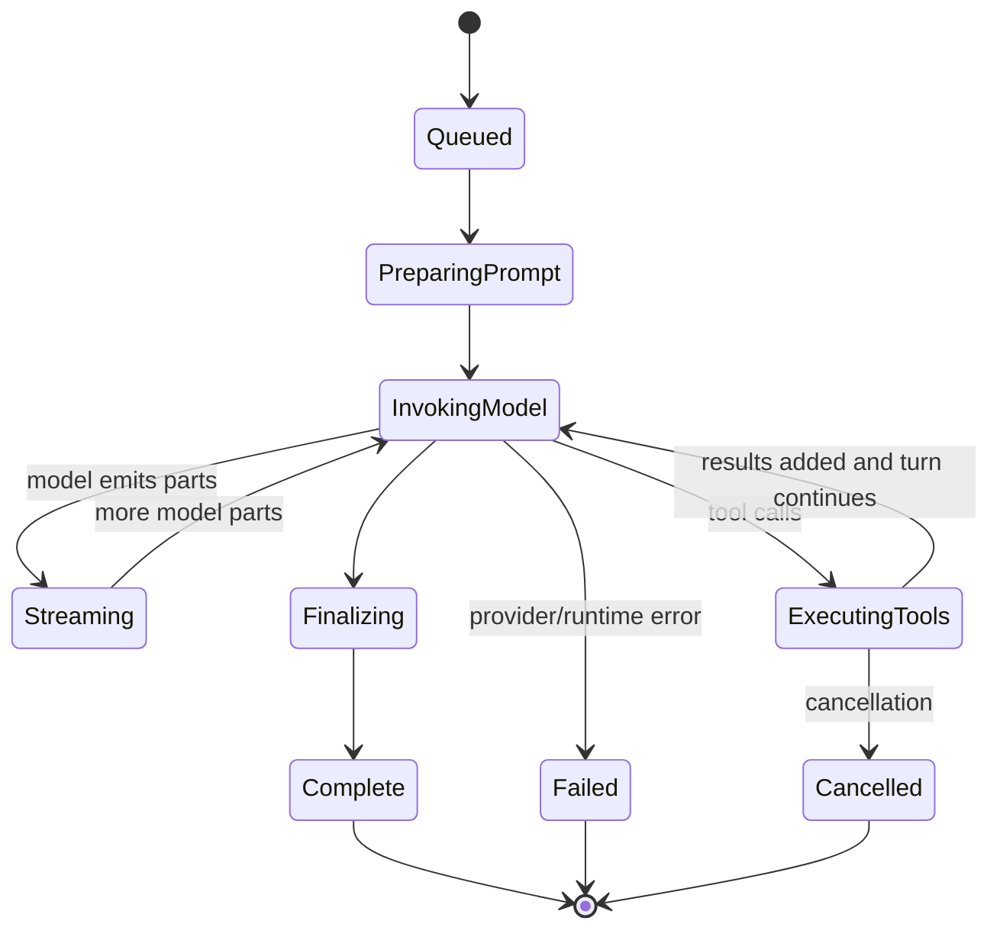

# Agent Lifecycle

## Verified structure

The core contains an agent registry (`packages/core/src/agent.ts`) and a session runner
organized as drain, prompt, LLM, and step modules:

- `packages/core/src/session/runner/index.ts`
- `packages/core/src/session/runner/prompt.ts`
- `packages/core/src/session/runner/llm.ts`
- `packages/core/src/session/runner/step.ts`
- `packages/core/src/session/runner/publish-llm-event.ts`

Exact provider-retry and continuation rules must be rechecked in `llm.ts` and provider
adapters for each implementation version.
