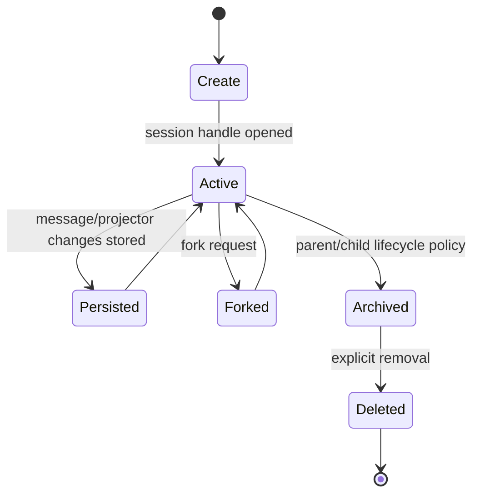

# Session Lifecycle

OpenCode session ownership spans `packages/core/src/session.ts`,
`packages/core/src/session/session.ts`, and persistence/projector modules. Exact fork,
archive, and delete semantics should be verified against source and server handlers before
implementation.

## HEX implementation implications

HEX's durable sessions are JSON files managed by `hex_cli/sessions/store.py`. Runtime state is
coordinated by `hex_cli/tui/state.py`. Native changes should preserve atomic writes and isolate
active runtime state from other sessions.
