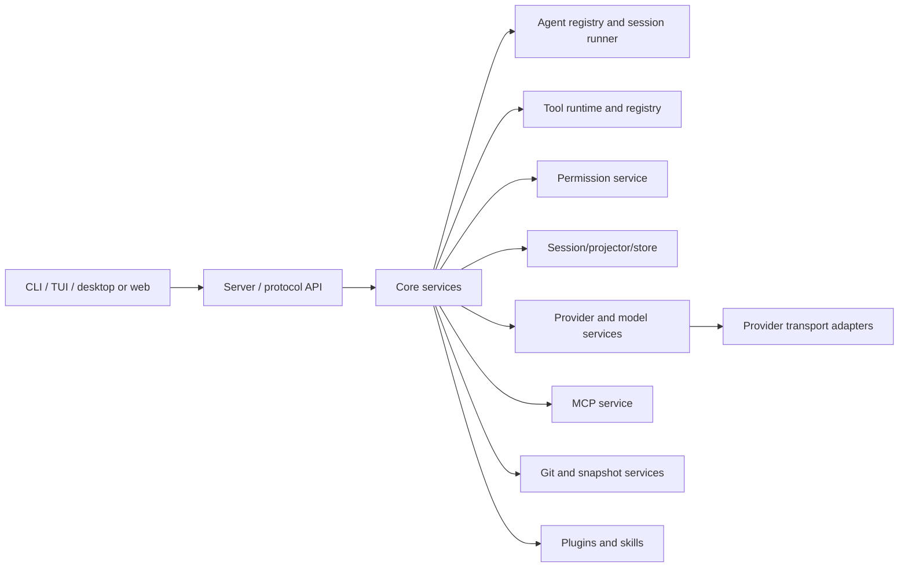
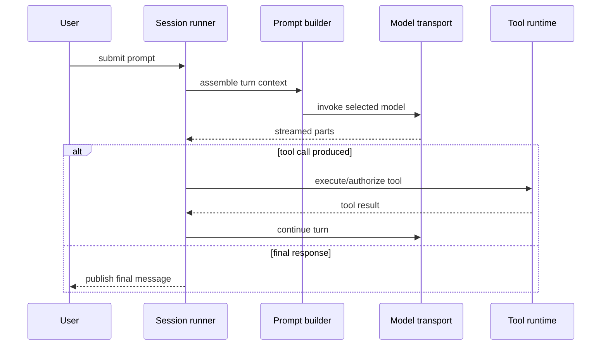
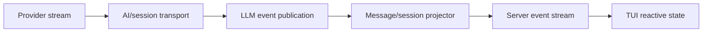
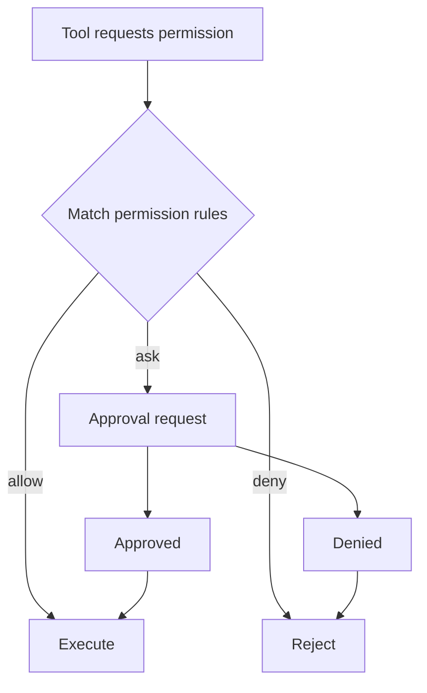
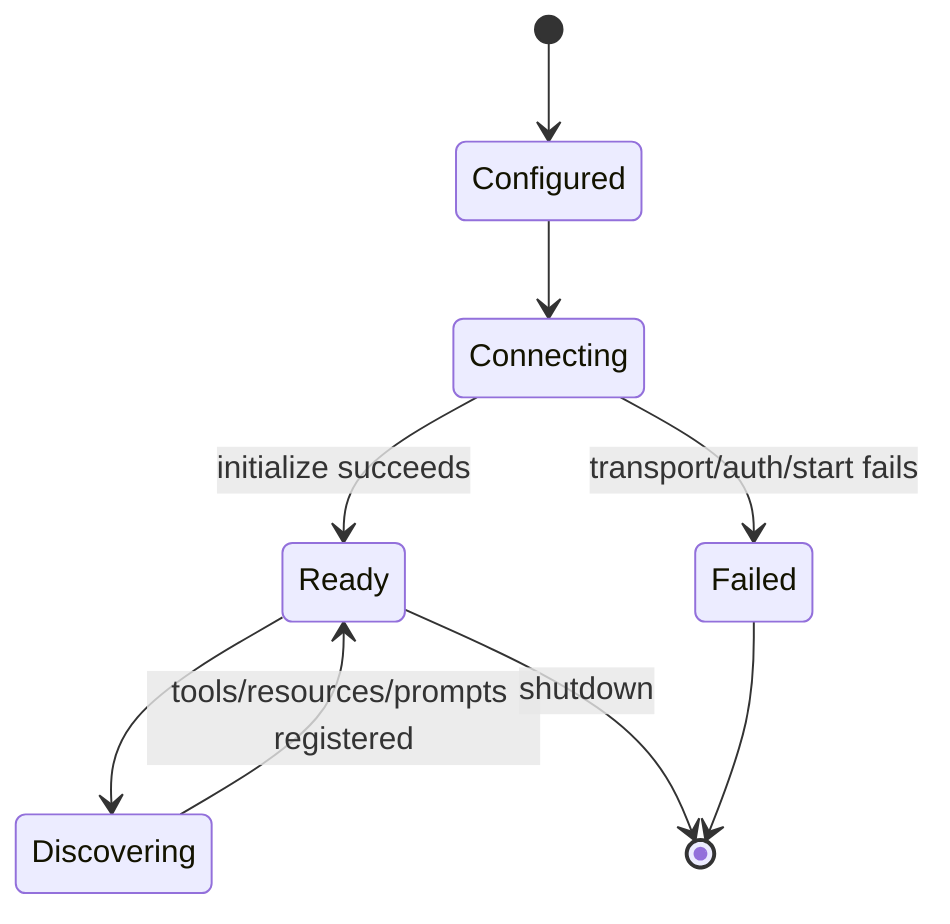
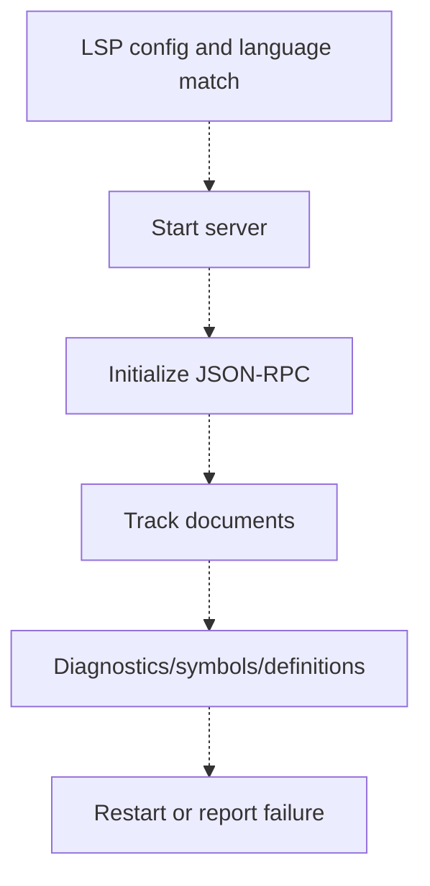

# OpenCode System Diagrams

## Overall architecture — source verified

## Prompt-to-model flow — partially verified

## Streaming flow — partially verified

## Permission approval — source verified

## MCP lifecycle — source verified structure

## LSP lifecycle — conceptual only

The dashed path is only a configuration-level finding at the inspected commit; core runtime
ownership was not established.
