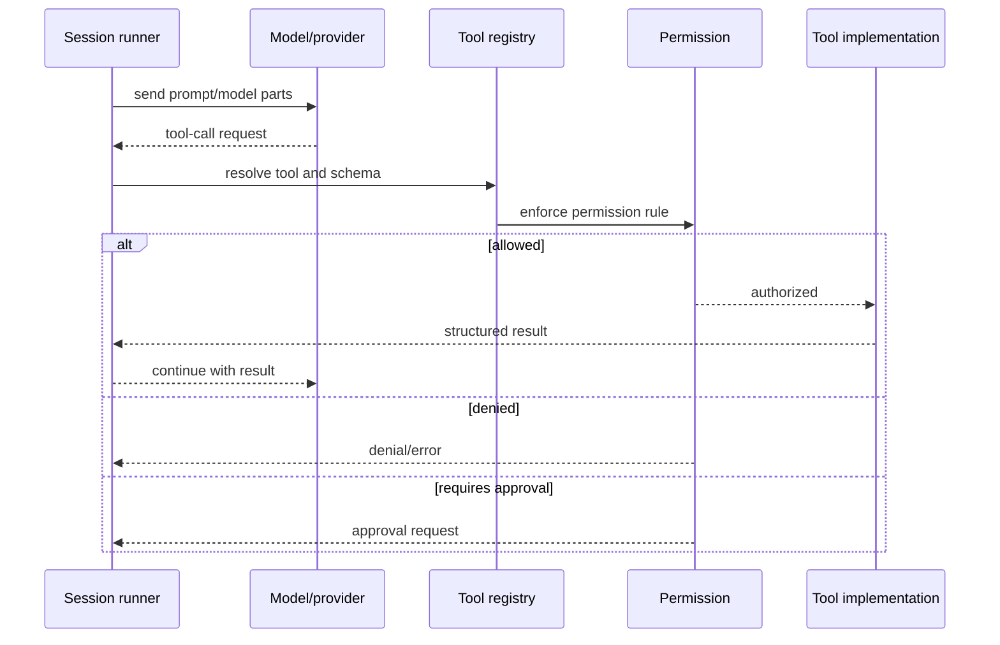

# Tool Execution Flow

The diagram describes verified architectural responsibilities. Validate current schemas and
result semantics against `packages/core/src/tool.ts`, `packages/core/src/tool/runtime.ts`,
and `packages/core/src/tool/plugin/**`.
