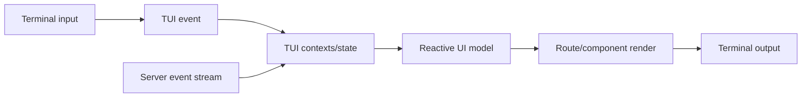
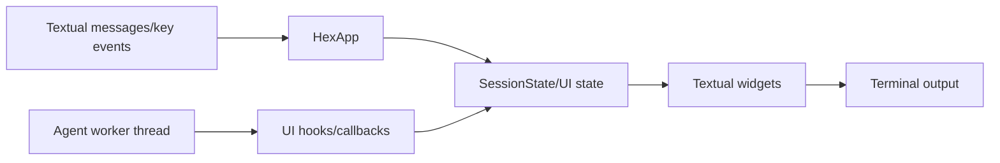

# TUI Rendering Flow

## Conceptual OpenCode flow

The concrete implementation is split among `packages/tui/src/app.tsx`, contexts, routes, and
components at commit `ff90ed91607cabf420a369e9009539c1aa0932af`.

## HEX flow — source inspected

