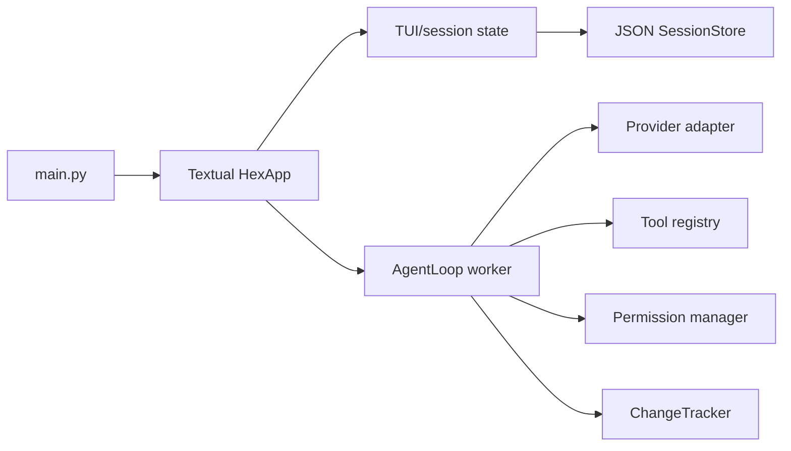

# HEX CLI Architecture

Inspected baseline: `ed3807ec2d48ffb21a093e7a50f94ba7bbf3af3c`, HEX CLI 1.5.1.

## Runtime

- `hex_cli/main.py`: Typer entry point and command-line startup.
- `hex_cli/tui/app.py`: Textual application, routing, workers, and UI hooks.
- `hex_cli/agent/loop.py`: bounded agent/tool loop and cancellation.
- `hex_cli/providers/*`: provider specifications, credentials, registry, and OpenAI-compatible
  transport abstraction.
- `hex_cli/tools/*`: filesystem, shell, project, Git, and tool schemas.
- `hex_cli/sessions/store.py` and `hex_cli/tui/state.py`: durable JSON sessions and runtime
  session state.
- `hex_cli/permissions.py`: policy evaluation and approval bridge.
- `hex_cli/changes/tracker.py`: in-session file diffs and undo/redo.

## State ownership

## Integration modules

- MCP: `hex_cli/mcp/client.py`; stdio connection and tool schemas.
- LSP: `hex_cli/lsp/client.py`; JSON-RPC client primitives.
- Subagents: `hex_cli/subagents/runtime.py`; library-level child loops.
- Skills: `hex_cli/skills/loader.py`.
- Custom commands: `hex_cli/commands_ext/loader.py`.
- Configuration: `hex_cli/config.py`.

These modules vary in production-loop integration. A module with a real client should not be
reported as implemented end-to-end until schemas, invocations, permissions, and UI behavior are
connected.
